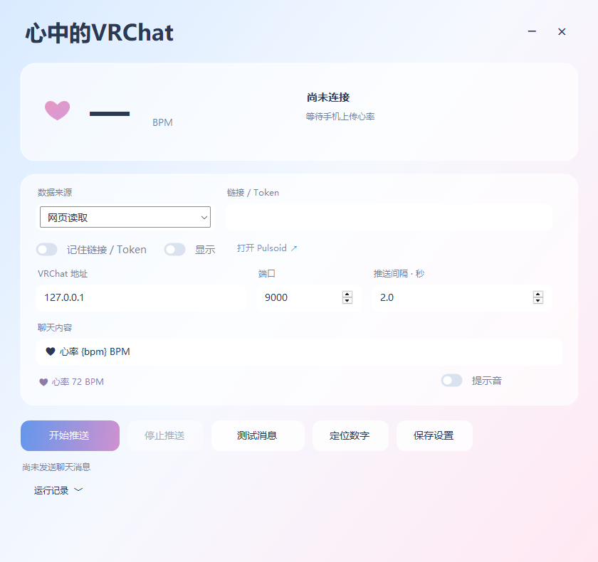

# 心中的VRChat 1.3



Windows 10/11 x64 中文桌面工具。点击「开始推送」后在后台读取 Pulsoid 心率组件网页，不弹出浏览器窗口，将心率发送到 VRChat 聊天框，**无需 Pulsoid API Token**。原有官方 API 模式仍可选。

## 下载

| 用途 | 入口 |
|---|---|
| 直接运行 Windows 软件 | [最新 GitHub Release](https://github.com/HakumomoHacha/HeartVRChat/releases/latest)，下载 `HeartVRChat-1.3.0-Windows-x64.zip` 并解压 |
| 获取源码或核对文件 | 同一 Release 提供源码压缩包和 `SHA256SUMS.txt` |
| 在 .NET 项目中使用核心库 | GitHub Packages 的 `HeartVRChat.Core`，包源为 `https://nuget.pkg.github.com/HakumomoHacha/index.json`；[安装说明](PulsoidVRC.Core/PACKAGE_README.md) |

Releases 中也附带 `.nupkg` 文件，可下载到自己的本地 NuGet 源使用。GitHub NuGet 源下载需要 GitHub 身份验证。

## 快速使用

准备 Windows 10/11 x64 电脑并安装 Edge 或 Chrome，手机和电脑保持联网。

| 步骤 | 操作 |
|---|---|
| 1. 上传心率 | 手机打开 Pulsoid App，连接心率设备并开启上传。 |
| 2. 复制链接 | 从 Pulsoid 复制自己的心率组件直链，确认无需额外登录即可看到变化的文字心率。 |
| 3. 设置游戏 | VRChat 动作菜单打开 `OSC → Enabled`，并在聊天框设置中允许 OSC 消息。 |
| 4. 填写软件 | 解压运行 `PulsoidVRC.exe`，选择「网页读取」，粘贴组件链接；同机地址保持 `127.0.0.1:9000`。 |
| 5. 开始推送 | 先点「测试消息」确认聊天框可用，再点「开始推送」，心率将在后台同步。 |

识别不明确时，停止后点击「定位数字」选择一次心率，再开始推送。数字连续 15 秒不变化会暂停发送，变化后自动恢复；点击「停止推送」即可结束。

## 界面更新

1.3 使用蓝、粉、白渐变与半透明平面卡片，窗口标题和托盘名称为「心中的VRChat」。主界面已移除副标题、使用说明和底部提示，运行记录默认折叠。支持顶部拖动、边缘调整窗口尺寸、最小化到托盘。

按钮悬停和按下提供轻量反馈；打开窗口短暂淡入，收到真实心率时播放心跳动画。遵循 Windows 客户区动画设置，隐藏界面后停止动画计时；未连接时不会播放模拟心跳。

## 手机到聊天框

**心率设备／广播工具 → 手机 Pulsoid App → Pulsoid 心率组件网页 → 本软件 → VRChat**

| 步骤 | 操作 |
|---|---|
| 1. 手机上传 | 在手机 Pulsoid App 中登录账号，连接兼容的心率设备／广播工具并开启上传。确保手机联网、蓝牙权限正常；锁屏后注意后台运行限制。 |
| 2. 准备组件网页 | 在自己的 Pulsoid 控制台找到心率组件，复制它的展示／浏览器源链接。先确认在浏览器中打开该链接能看到实时变化的心率。请使用组件直接链接，不要使用组件编辑器或包含嵌入 iframe 的控制台。 |
| 3. 打开软件 | 解压后双击 `PulsoidVRC.exe`。数据来源保持「网页读取」，在「链接 / Token」粘贴组件网址。 |
| 4. 后台启动 | 点击「开始推送」，后台自动识别页面唯一的可见数字，不打开网页窗口。若提示存在多个数字，停止后单独点击「定位数字」，在设置窗口选择一次心率；窗口随后自动关闭，位置会保存。再点击「开始推送」即可后台运行。 |
| 5. 配置 VRChat | 游戏动作菜单打开 `OSC → Enabled`，聊天框设置中允许 OSC 消息。同机默认使用 `127.0.0.1:9000`。 |
| 6. 确认显示 | 窗口显示读数，聊天框默认约每 2 秒更新 `♥ 心率 82 BPM`。也可在开始前点击「测试消息」单独检查 OSC 通路。 |

手机和电脑不需要在同一 Wi-Fi，均需联网。Windows 端需要 Edge 或 Chrome，无需额外安装 Python、Node.js、.NET 或浏览器扩展。程序使用独立临时浏览器配置，不接管已经打开的个人浏览器窗口。日常推送使用无窗口浏览器；停止或退出时结束后台浏览器。只有手动点击「定位数字」才会打开设置窗口，定位操作不发送 OSC 消息。定位结果绑定该组件网址，换链接后不会套用旧位置。

## 网页读取的边界

| 情况 | 行为 |
|---|---|
| 网页数字变化 | 约每 350 毫秒读取一次所选文字；使用最新数值发送 OSC，不堆积消息。 |
| 数字连续 15 秒不变 | 暂停发送，变化后恢复。网页无法区分稳定心率和页面卡住，因此使用此保守策略。 |
| 网页刷新 | 自动重新加载读取逻辑，按保存的位置或唯一数字规则恢复。组件结构变化导致定位失败时停止后重新定位。 |
| 数字隐藏、消失或定位不唯一 | 暂停发送，等待页面恢复；必要时停止后「定位数字」。元素替换但数值未变化不会被当成新心率。 |
| 心率用图片、Canvas 或 SVG 绘制 | 此版本不做 OCR，不能读取这类数字。请切换为文字数字式组件。 |
| 心率位于 iframe | 请使用心率组件本身的直接网址。 |
| 页面本身需要登录 | 后台模式使用独立临时浏览器，不继承个人浏览器或定位窗口的登录状态。请使用无需额外登录即可展示的个人组件直链；仍需拥有该链接的访问权限。 |
| 后台浏览器故障 | 停止读取并提示错误，不自动弹出窗口；点击「开始推送」重试。 |

此模式读取的是网页显示值，没有传感器原始测量时间戳。第一次选择时将当前显示值作为起始读数；使用前应确认组件确实在实时变化。如果真实心率长时间保持同一整数，也会在 15 秒后暂停，这属于网页模式的已知取舍。

## 设置

| 设置 | 说明 |
|---|---|
| 网页链接 | 支持 HTTPS 的 `pulsoid.net` 及其子域名。链接应来自你自己的组件。 |
| 定位数字 | 仅此按钮会打开网页设置窗口；点击目标数字后保存位置并自动关闭。已保存位置找不到时不会改读其他数字。 |
| 显示 | 输入默认遮蔽，因为组件链接可能包含私人分享标识；勾选后可查看。 |
| 记住链接 / Token | 默认关闭。勾选并保存后，使用 Windows DPAPI 加密，只能由当前 Windows 用户解密。取消勾选会移除已保存的链接和 Token。 |
| VRChat 地址／端口 | 同机为 `127.0.0.1:9000`；如修改过 VRChat 的 OSC 输入端口，请同步调整。 |
| 更新间隔 | 默认 2 秒，支持 1.5–60 秒。若游戏限流，可增大间隔。 |
| 聊天内容 | 必须包含 `{bpm}`，例如 `♥ 心率 {bpm} BPM`。替换后最多 144 个 UTF-16 字符单元。 |
| 聊天通知音 | 默认关闭。 |
| 最小化与退出 | 程序最小化后进入托盘继续工作，双击托盘图标恢复；关闭程序会停止推送。浏览器本身不显示窗口。 |

配置位置：`%LOCALAPPDATA%/PulsoidVRC/settings.json`。默认不保存组件链接或 Token；窗口只记录近期状态，不保存心率历史，不记录完整链接或 Token。临时浏览器配置退出时尝试清理；若系统文件占用导致清理失败，可能残留在 Windows 临时目录 `PulsoidVRC-Browser-*` 中。

## 可选官方 API 模式

数据来源切换为「官方 API」后，输入同一账号的 Access Token，需要 `data:heart_rate:read` 权限。手动创建 Token 是 Pulsoid BRO／试用功能，入口为 https://pulsoid.net/ui/keys 。**网页模式不需要该 API Token。**

API 模式具有自动重连、原始测量时间过滤，不要求打开组件网页。它与网页模式使用相同的 OSC 消息、模板、节流和托盘功能。

## 排查

| 问题 | 处理 |
|---|---|
| 手机没有心率 | 检查广播设备是否兼容 Pulsoid、蓝牙权限及设备是否被其他 App 独占。 |
| 网页没有实时变化 | 先排查手机上传、账号、网络或组件设置；软件无法产生页面没有的数据。 |
| 自动识别不明确 | 先停止推送，再点击「定位数字」。唯一数字规则只用于专用心率组件，若选错目标应手动定位。 |
| 点击无法识别 | 直接点击单个心率数字。支持 1–300 的整数，可带心形符号或 BPM；不接受同时包含多个数值的区域。图片／Canvas／SVG 需要换文字式组件。 |
| 浏览器启动失败 | 安装 Edge 或 Chrome。被组织管理的浏览器可能禁止远程调试。 |
| 已发送但游戏无消息 | UDP 没有收件确认；检查 OSC、聊天框 OSC 允许项、输入端口和其他会覆盖聊天框的软件。 |
| 其他玩家看不到 | 检查其 VRChat 聊天框可见范围和社交过滤设置。 |

## 开发与验证

使用 Windows 上的 .NET 9 SDK 构建。产品为 .NET 8 自包含 Windows x64 应用，打包 .NET 8.0.33 运行库，相关许可见 `licenses/`。

```powershell
./build.ps1
```

生成发布压缩包、对应源码、NuGet 包和校验文件：

```powershell
./package.ps1
```

文件写入 `artifacts/`。推送与项目版本一致的 `v*` 标签后，发布工作流会运行测试、构建并上传 GitHub Releases 与 GitHub Packages。

| 源码 | 内容 |
|---|---|
| `PulsoidVRC/` | WinForms 界面、托盘、加密设置；`MainForm.View.cs` 定义布局，`Theme.cs` 定义渐变、透明卡片与动画控件 |
| `PulsoidVRC.Core/BrowserReader.cs` | 独立浏览器管理、CDP 通信、网页读数与新鲜度判断 |
| `PulsoidVRC.Core/WebReader.js` | 网页数字点选与读取，只接受可见的单个整数 |
| `PulsoidVRC.Core/` 其他文件 | Pulsoid API 客户端、缓存、OSC 编码与发送节流 |
| `PulsoidVRC.Tests/` | 15 组测试，包括本机模拟 API、真实无头 Edge 网页 → OSC UDP 通路 |

测试不使用真实 Pulsoid Token，不向真实 VRChat 默认端口发包。`PulsoidVRC.exe --smoke-test` 可离线检查窗口渲染，不读取真实配置、不连接网络。本次增加了后台自动识别、多数字拒绝、保存位置匹配、位置失效不误读、定位回调完成，以及反复替换元素但数字不变仍过期的集成测试。

尚未针对你的实际私人组件链接进行联调；如组件采用不支持的绘制方式，需换文字式组件。

参考：https://docs.pulsoid.net/ ，https://docs.vrchat.com/docs/osc-overview ，https://docs.vrchat.com/docs/osc-as-input-controller#chatbox 。本工具为独立实现，非 Pulsoid／VRChat 官方发行版。

## 开源许可

Copyright (C) 2026 HakuChya (HakumomoHacha)。本项目源码采用 **GNU GPL v3，仅第 3 版（GPL-3.0-only）**，完整条款见 [LICENSE](LICENSE)。你可以依照该许可使用、修改和分发本项目；分发修改版或二进制时，应按 GPL 要求提供对应源码和许可信息。软件不提供担保。

随自包含程序分发的 .NET 运行库保留其原有许可，详见 [NOTICE](NOTICE) 和发布目录的 `licenses/`。GitHub Actions 在推送与拉取请求时执行测试并构建 Windows 便携程序，产物可从对应 Actions 运行的 Artifacts 下载。
